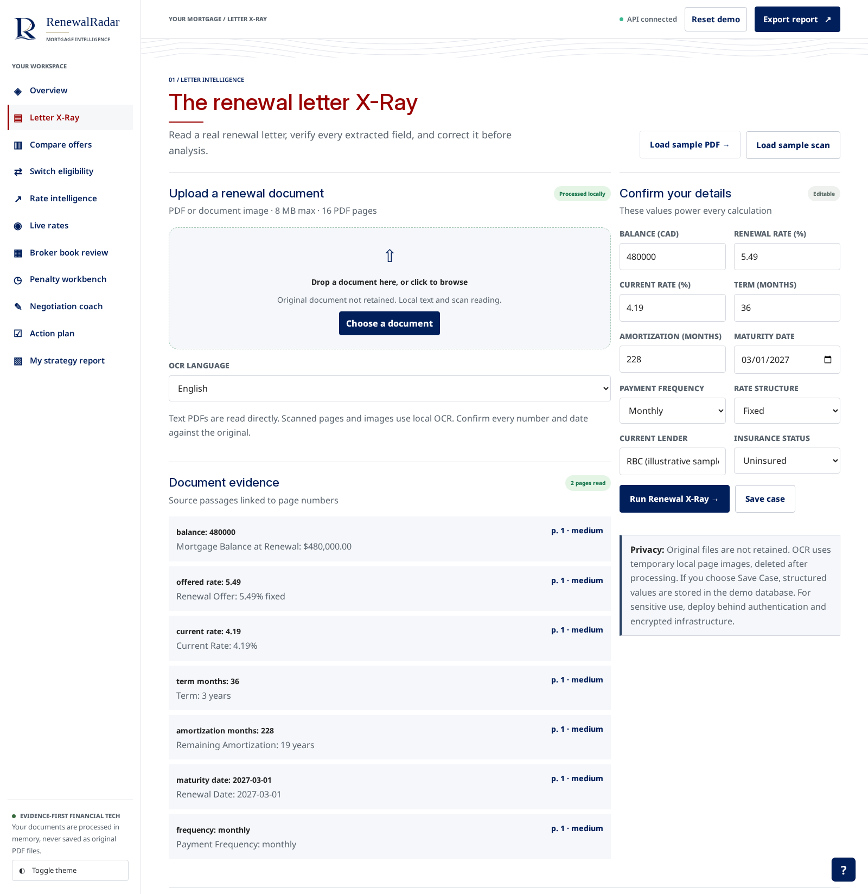
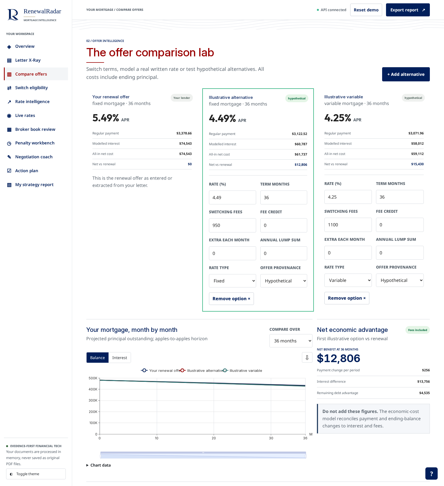
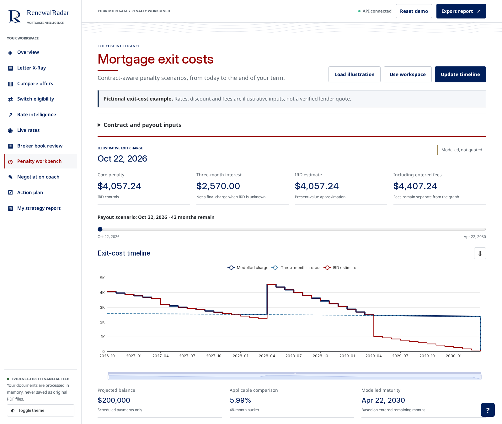

# Renewal Radar

**Understand your mortgage renewal before you sign.**

Renewal Radar reads your renewal letter, compares mortgage offers, checks whether switching lenders might require another stress test, works out the cost of breaking a mortgage early using the lender's own published method where one exists, and helps you prepare for a conversation with your lender.

*By John Khan*

**Live demo:** https://renewal-radar-nplp.onrender.com

**Demo video (under 2 minutes):** https://youtu.be/77fjUXwTWYE

**Code:** https://github.com/ALENZACODES/renewal-radar

The live demo runs on a free Render plan. If nobody has used it for a while, the first page can take about a minute to wake up.

## Prior work and what was built during Build Week

Renewal Radar existed before Build Week. Build Week submissions opened on October 16, 2026 at 12:00 PM ET. The git history has 119 commits: **96 came before Build Week** (October 12 up to commit `3d95a4f`, October 16 at 11:47 AM ET) and **23 came during Build Week** (`7f4381e` to `91a6020`, October 16 at 12:48 PM ET to October 22). Run `git log 3d95a4f..91a6020` to see exactly what was added during the event.

I wrote the October 12 to 15 code with help from AI coding assistants (Claude, ChatGPT and GitHub Copilot), and I reviewed and tested the changes.

A detailed list of what came when is in [Built during Build Week](#built-during-build-week).

## At a glance

| | |
|---|---|
| **Who it is for** | A Canadian homeowner whose fixed rate mortgage is coming up for renewal and who has the renewal letter in hand. |
| **What it does** | Turns that letter into a side by side offer comparison, a stress test switch check, a penalty figure, a negotiation script and a dated action plan. |
| **Why the numbers can be trusted** | Penalty methods for fourteen lenders were checked against those lenders' own published calculators. Every financial figure comes from tested code. The optional language model only explains results that were already calculated. |
| **Try it in one minute** | Open the live demo, go to **Letter X-Ray** and select **Load sample PDF**. No personal information is needed. |

## Screenshots

All three show the illustrative sample case running in demo mode.

**Letter X-Ray.** The sample letter after **Load sample PDF**. Each extracted value is listed with the page it came from, and the fields on the right can be corrected before any calculation.



**Compare offers.** The 5.49% renewal offer next to a hypothetical 4.49% fixed and a hypothetical 4.25% variable alternative, with the net result after fees.



**Penalty workbench.** The built in illustrative exit cost example, with three months' interest, the interest rate differential and how the charge changes until maturity.



## The problem

A renewal letter gives you a rate and asks for a signature. It does not tell you what a lower rate could save over the term, whether you can switch lenders without passing the stress test again, or how much breaking your current mortgage would cost.

Many Canadians are facing that letter now. The Bank of Canada's Financial Stability Report 2026 says that over the next 12 months, the last of the five year, fixed payment mortgages taken out during the pandemic will renew. That group is about 12% of all outstanding mortgages in Canada, and on average those borrowers will see their payments rise by about 15%. ([Bank of Canada, Financial Stability Report 2026, Households](https://www.bankofcanada.ca/publications/financial-stability-report/financial-stability-report-2026/households/))

Penalties are where generic tools go wrong. Lenders do not all calculate early repayment penalties the same way, so one generic interest rate differential formula may not reproduce what a particular lender charges. Renewal Radar uses the lender's own published calculator method where one is available and labels everything else as an estimate. The lender's written payout statement is always the final word.

## Try the sample case

Renewal Radar ships with an illustrative sample renewal letter labelled **RBC (illustrative sample)**, so you can examine every calculation without entering personal information. It is not an RBC document and was not issued or endorsed by RBC, and the letter says so on every page. RBC appears as a text name only, with no logo. The letter shows a **$480,000** balance, **19 years** of remaining amortization and a **3 year fixed renewal offer at 5.49%**. The app compares it with a **hypothetical alternative at 4.49%**.

| | Renewal offer | Hypothetical alternative |
|---|---:|---:|
| Interest rate | 5.49% | 4.49% |
| Monthly payment | $3,378.66 | $3,122.52 |
| Interest over 36 months | $74,542.72 | $60,786.65 |

Over the 36 month term, the hypothetical alternative produces **$13,756.07 less interest** and a **$4,535.04 lower remaining balance**. Those two figures are before switching costs. The sample alternative carries an illustrative $950 in fees, and the app's net cost comparison includes them, which narrows the gap to $12,806.07.

Do not add the monthly payment saving to the interest saving. The interest figure already reflects the payment difference. The 4.49% rate is hypothetical. It is not a lender quote, an available offer or a promise of savings.

**On the live demo:** open **Letter X-Ray**, select **Load sample PDF**, check each extracted value against the page it came from, then work through Compare offers, Switch eligibility, Penalty workbench and the strategy report. The demo runs on a free server that sleeps when idle, so the first page can take about a minute to load. The sample scan path runs OCR and can be slow there, so start with the PDF.

**Locally:** follow [Run Renewal Radar locally](#run-renewal-radar-locally) and take the same steps.

## Penalty calculations checked against lender calculators

The penalty engine implements the published calculator methods of fourteen lenders. For thirteen of them, the lender's own public calculator code was downloaded and run in Node as the answer key. Random mortgages went through both that code and Renewal Radar, and the two had to agree to the cent.

| Lenders | Validation |
|---|---|
| TD, Scotiabank, CIBC, BMO, National Bank, Desjardins, Tangerine, Simplii, ATB, Haventree, Laurentian, Equitable, Bridgewater | 3,000 random cases each, all equal to the cent |
| RBC | 34 recorded answers from RBC's online calculator, all within $0.30, including 12 exact to the cent |

RBC's calculator runs on RBC's own server, so it could not be run locally like the others. Its 34 answers were recorded and the engine is checked against them offline. The calculator files are fetched by scripts in `tools/` and are never committed to the repository. The methods, the rules found in each lender's code and the supporting records are in `docs/RATEWATCH.md`.

These checks show agreement with the published calculators for the cases tested. They do not replace a lender's current payout statement. For lenders without a supported method, the penalty is labelled as an estimate.

## Competitors, and why Renewal Radar wins

Renewal Radar is not the first renewal tool in Canada. Penalty calculators, rate tables and renewal payment calculators already exist. The table below describes each one using only what its own public page shows, as of October 22, 2026. We have no accuracy figures for any of them and make no claims about their accuracy.

| Tool | What it does | Where Renewal Radar differs |
|---|---|---|
| Big bank prepayment charge calculators: [RBC](https://www.rbcroyalbank.com/cgi-bin/mortgage/tools/prepayment/prepayment-charge-calculator.cgi/), [TD](https://apps.td.com/mortgage-prepayment-calculator/), [CIBC](https://www.cibc.com/en/personal-banking/mortgages/calculators/prepayment-calculator.html) | Each bank's own penalty estimate for its own mortgages, from figures you type in. | Each covers one lender. Renewal Radar uses these calculators as its answer keys, then adds letter reading, offer comparison, a switch check and a plan. |
| [Ratehub.ca](https://www.ratehub.ca/mortgage-renewal-calculator) | Compares rates across lenders, estimates renewal payments, and explains three months' interest and IRD with a penalty calculator. | Its pages explain the general penalty formulas. They do not say they reproduce each lender's own method, and they do not read your renewal letter. |
| [WOWA.ca](https://wowa.ca/calculators/mortgage-penalty-calculator) | Estimates a break penalty from common lender formulas, with a pick list of major banks, plus a rate comparison across 50+ lenders. | Its page does not describe checking results against each lender's own calculator. No letter reading, switch check or action plan. |
| [nesto](https://www.nesto.ca/mortgage-renewal/) | Online lender. Explains the main penalty types and invites renewing borrowers to transfer their mortgage to nesto. | Its tools lead to its own mortgage. Renewal Radar has no lender partnerships and compares your own letter against whatever offers you have. |
| [Finmo by Lendesk](https://www.lendesk.com/finmo), [Filogix](https://www.filogix.com/) | Mortgage technology for brokers and institutions: applications, documents, submissions, deal management. | Built for processing deals, not for a homeowner deciding what to do with a renewal letter. |

### Why Renewal Radar wins

None of these tools, as far as their public pages show, does the whole job in one place. Renewal Radar starts from the borrower's actual renewal letter and shows the page and text behind every number it extracts. It compares offers over the same horizon, so a lower payment cannot hide a higher total cost. It checks whether a straight switch might avoid a new stress test under the late 2024 rules. It calculates the cost of breaking early using the lender's own published method. It then turns all of this into a phone script, a counteroffer email and a dated plan up to maturity.

The penalty engine is where the difference can be measured. For 13 lenders whose calculators run in the browser, we ran each lender's own code, unmodified, as the answer key. 3,000 random mortgages per lender went through both, and all 39,000 matched to the cent. RBC's calculator runs on RBC's server, so we recorded 34 of its answers. Renewal Radar matches all 34 within $0.30, and 12 of them to the cent. Those are calculator validation results, not tests against real borrower payout statements. Actual penalties still need confirmation from the lender.

### Honest limits

Renewal Radar has no lender partnerships and no real user base yet. No real borrower letters, payout statements or penalty quotes have been run through it. Every check so far used random or recorded inputs. A lender can change its calculator at any time, so the methods need to be rechecked whenever that happens.

## What Renewal Radar does

The application has eleven screens.

| Screen | What you do there | Built in guardrail |
|---|---|---|
| **1. Overview** | See the balance, offered rate, payment, possible savings and balance curves together. | |
| **2. Letter X-Ray** | Upload a text based renewal letter PDF. The balance, rate, amortization, term and other available fields are extracted. | Shows the page and the text each value came from, and lets you correct it before use. Scanned letters need OCR. |
| **3. Compare offers** | Compare fixed and variable offers over the same time horizon, adjusting term, payment frequency, fees, lump sums and extra payments. | Shows payment, interest paid and remaining balance, so a lower monthly payment is not mistaken for a lower total cost. |
| **4. Switch eligibility** | Check whether switching to another lender at renewal might qualify for stress test relief. | Reports potential eligibility only. It does not approve a mortgage or promise that a lender will accept an application. |
| **5. Rate intelligence** | View Bank of Canada data: the policy rate, the 1, 3 and 5 year conventional mortgage rates, the prime rate and the 5 year Government of Canada bond yield. | Every value is shown with its observation date. |
| **6. Live rates** | Read lenders' publicly posted rates from their own websites, feeds or PDF documents. | Retrieved, manual and unavailable readings are labelled differently. If a lender blocks automated access or a reading is unclear, no rate is invented. |
| **7. Book review** | Import several mortgages from CSV, JSON or a scanned table and see which would save interest by breaking now at today's rates. | |
| **8. Penalty workbench** | Work out the cost of breaking a mortgage before maturity, and see what to confirm in the lender's written payout statement. | Uses the lender's published method where available, otherwise a labelled estimate. |
| **9. Negotiation coach** | Get a phone script, a counteroffer email and questions to ask your lender. | Hypothetical rates and calculations are kept separate from actual lender offers. |
| **10. Action plan** | Create dated steps leading up to the maturity date, plus a calendar file you can import. | |
| **11. Strategy report** | Generate a PDF with the mortgage figures, relevant rules and supporting sources. Save cases and create read only share links that expire. | Saved cases use individual case tokens. See [Security and ethics](#security-and-ethics). |

### Switch eligibility rules

The check looks at whether the mortgage is insured or uninsured, whether both lenders are federally regulated, whether the mortgage is a standalone loan or combined with another loan, whether the borrower is taking out extra equity, whether the amortization changes, and the $3,000 allowance for certain switching costs.

These rules changed in late 2024. For uninsured mortgages, the federal straight switch exemption took effect on November 21, 2024. For low ratio insured mortgages, meaning a loan to value of up to 80%, the Finance Canada change applies to mortgage insurance applications that lenders submit on or after December 16, 2024.

In the sample case, the switch shows as potentially exempt. Enter any cash out above zero and it moves to new underwriting.

## Historical mortgage rates

Renewal Radar includes five years of posted mortgage rate history: **October 2021 to October 2026, 61 months**. It was rebuilt from the big banks' own archived rate pages and feeds, retrieved through the Internet Archive, Common Crawl and Arquivo.pt.

Where no archived reading exists for a bank in a given month, the Bank of Canada typical posted mortgage rate is used and marked as a fill. A filled observation is never presented as a bank's current posted rate. The month by month evidence is in `data/ratewatch/history_audit.csv`, and the method is in `docs/RATEWATCH.md`.

## Security and ethics

* **Numbers come from code, not a model.** Mortgage, eligibility and penalty calculations are deterministic and tested. The optional language model only explains results that were already calculated, and the application works fully without it.
* **No invented data.** Unavailable lender rates are never replaced with guesses. Retrieved rates, manual readings, historical fills and penalty estimates are each labelled as what they are.
* **Hypotheticals stay hypothetical.** Hypothetical rates are kept apart from actual lender offers everywhere, including in the negotiation coach.
* **You can check the source.** Extracted letter values show the page they came from and can be corrected. Rules, rates and reports cite public sources.
* **The public demo cannot store anything.** The live demo runs with `APP_ENV=demo`. Only the samples, the market data reads and the calculations that keep no state are open. Saving cases, issuing tokens, refreshing sources and anything else that stores data is refused with a 403, and the interactive API documentation is switched off. The demo runs without API keys, so it cannot spend anyone's credits.
* **Fewer outside calls.** The core application needs no account or API key. The browser helper runs without a key or a network call. Fonts and chart code are bundled rather than loaded from a CDN.
* **Saved cases have a known limitation.** When run locally, cases are stored in unencrypted SQLite and protected by individual case tokens, not user accounts. Share links are read only and expire. **Do not put real personal information into a publicly reachable copy of the application in its current form.**
* **Not advice.** Renewal Radar is a decision aid. It does not provide financial advice, a binding mortgage quote or a lending approval. No bank or government agency endorses this project.

## How it works

Renewal Radar keeps the financial calculations separate from the explanatory text.

* **Backend:** Python, FastAPI and Pydantic. PyMuPDF reads PDFs and ReportLab creates the PDF reports. Saved cases use SQLite through SQLAlchemy. Interactive API documentation is at `/docs` when the app runs locally (it is off in demo mode).
* **Frontend:** plain HTML, CSS and JavaScript, with charts in Apache ECharts.
* **Mortgage math:** Canadian fixed mortgage rates use semiannual compounding. The offer comparison runs a month by month schedule for each offer and compares payments, interest and remaining balances rather than rates alone. Totals are rounded to the cent at the end of the schedule.
* **Penalty engine:** each supported lender's method is coded separately, including the lender's own rounding and term rules, and checked against that lender's calculator as described above.
* **Optional AI explanations:** add a Nebius API key to `.env` to turn on explanations from an NVIDIA Nemotron model. It does not calculate payments, interest, penalties or eligibility.
* **Browser helper:** a small question answering helper that uses a word based classifier rather than a large language model.

```
frontend/                   screens, charts, helper
backend/renewal/main.py     API
backend/renewal/domain/     mortgage calculations and switch rules
backend/renewal/ratewatch/  lender rates, history, penalty engines, recorder
backend/renewal/services/   letter extraction, Bank of Canada data, reports, plans, saved cases
tools/                      lender calculator retrieval and testing scripts
data/                       Bank of Canada series, rate history and audits
tests/                      Python and Node tests
```

## Testing

Both suites were rerun on October 22, 2026, at commit `91a6020`:

| Suite | Result |
|---|---|
| Python | 1,577 passed, 13 skipped, with Tesseract installed |
| Frontend | 270 passed |

```bash
PYTHONPATH=backend pytest -q
npm test
```

The frontend tests need Node 20 or newer. Node is not needed to run the app. Without Tesseract, the OCR tests are skipped. The penalty calculator comparisons are documented separately in `docs/RATEWATCH.md`.

## Run Renewal Radar locally

You need Python 3.11 or newer. No account or API key is needed for the core application. Live rate data needs an Internet connection.

```bash
git clone https://github.com/ALENZACODES/renewal-radar.git
cd renewal-radar
python -m venv .venv
source .venv/bin/activate
pip install -r requirements.txt
PYTHONPATH=backend uvicorn renewal.main:app --host 127.0.0.1 --port 8000
```

On Windows, activate the environment with `.venv\Scripts\activate`, or simply double click `Start Renewal Radar.cmd`.

Then open http://127.0.0.1:8000, go to **Letter X-Ray** and select **Load sample PDF**.

To run it the same way as the public demo, add `APP_ENV=demo` in front of the start command.

### Docker

The Dockerfile serves the API and the frontend from one container, with Tesseract included for scanned documents.

```bash
docker build -t renewal-radar .
docker run -p 8000:8000 -e APP_ENV=demo renewal-radar
```

`docker compose up --build` also starts it in demo mode.

Then open http://localhost:8000.

The hosted demo is deployed from `render.yaml`, which builds this same Dockerfile on a free Render web service with `APP_ENV=demo` and a health check at `/health`.

## Data sources

**Bank of Canada**

* [Valet API](https://www.bankofcanada.ca/valet/docs), with these series:

| Series | What it is |
|---|---|
| `V39079` | Target for the overnight rate (the policy rate) |
| `V80691333` | Conventional mortgage, 1 year |
| `V80691334` | Conventional mortgage, 3 year |
| `V80691335` | Conventional mortgage, 5 year |
| `V80691311` | Prime rate |
| `BD.CDN.5YR.DQ.YLD` | Government of Canada 5 year benchmark bond yield |

* [Bank of Canada terms of use](https://www.bankofcanada.ca/terms/)
* [Financial Stability Report 2026, Households](https://www.bankofcanada.ca/publications/financial-stability-report/financial-stability-report-2026/households/)

**Qualification and switching rules**

* [Uninsured mortgage straight switches, federal guidance](https://www.osfi-bsif.gc.ca/en/guidance/guidance-library/osfi-exempts-uninsured-mortgage-straight-switches-prescribed-mqr-implements-portfolio-lti-limits)
* [Minimum qualifying rate for uninsured mortgages](https://www.osfi-bsif.gc.ca/en/supervision/financial-institutions/banks/minimum-qualifying-rate-uninsured-mortgages)
* [Finance Canada, straight switches and portfolio insurance](https://www.canada.ca/en/department-finance/news/2024/12/straight-switches-and-portfolio-insurance.html)

**Lender rates and calculator methods**

Collected from public lender pages, feeds and PDF documents that need no login. The source list and validation method are in `docs/RATEWATCH.md`, and the historical audit is in `data/ratewatch/history_audit.csv`.

## Limitations

* **Lender decisions:** the lender decides whether an application is accepted. A potential stress test exemption is not an approval.
* **Penalties:** the lender's written payout statement is authoritative. A calculator method that matched past test cases cannot guarantee a future payout amount. Unsupported lenders get labelled estimates.
* **Documents:** Letter X-Ray reads text based PDFs. Scanned documents need Tesseract, which the Docker image includes.
* **Published rates:** some lenders block automated reading. Those rates are shown as unavailable or as labelled manual readings.
* **Historical observations:** missing archived bank rates are filled with the Bank of Canada typical posted rate and labelled as fills.
* **Saved cases:** unencrypted SQLite with case token access, and no user accounts yet. The public demo has saving turned off.
* **Hosting:** the live demo runs on a free plan. It sleeps after a period of no traffic and keeps no data between restarts.
* **Sample:** the example is illustrative. Its results do not show that a lender will offer that rate or that switching will produce those savings after costs.

## Path to production

Renewal Radar can already run outside my machine. The repository includes a Docker image, a Render blueprint, a public demo mode that refuses every route that stores data, a production mode that will not start without its access keys, a daily rate recorder with retries, backup sources and a watchdog, and the harnesses that check each penalty method against the lender's own calculator.

A real launch still needs a few things: user accounts in place of case tokens, encrypted storage for saved cases, hosting that does not sleep when idle, and a routine that reruns the lender calculator checks whenever a lender changes its calculator, so a method never drifts unnoticed. It also needs its first real users, because every check so far has used random or recorded inputs rather than real borrower letters.

## Built during Build Week

The commit split is at the top of this README. This is what each part contains.

**Before Build Week (October 12 to the morning of October 16):** the core application. That includes the mortgage math and switching rules, letter extraction, the browser interface, the general penalty workbench, the Bank of Canada data, reports, action plans, saved cases with share links, the test suite and CI. It also includes the Book review screen, the security gates, the exact penalty methods for TD, Scotiabank, CIBC, BMO and National Bank, and the first build of the five year rate history from web archives, which was refreshed again during Build Week.

**During Build Week (October 16 at 12:00 PM ET onward):**

* The daily rate recorder, with retries, backup sources and a watchdog (October 16 and 17).
* RBC's penalty method rebuilt from 34 recorded answers of RBC's own calculator (October 18).
* Exact penalty methods for Desjardins, Tangerine and Simplii (October 18).
* Exact penalty methods for ATB, Haventree, Laurentian, Equitable and Bridgewater (October 18).
* Posted rates read from thirteen smaller lenders' own websites (October 18).
* Fixes for dead source links, and the sample letter relabelled as an illustrative RBC sample with a footer saying it is not an RBC document (October 22).
* The public demo mode, the Docker image with Tesseract, Docker Compose set to demo mode and the free Render deployment (October 22).
* The demo video (October 22).

So nine of the fourteen validated lender methods were built during Build Week.

## Team

John Khan (solo).

## Partner platforms

Renewal Radar does not use Expo, Clerk, Eon or SurrealDB.

## AI tools disclosure

I used several AI tools to build Renewal Radar, and I want judges to see exactly where.

- **Claude (Anthropic).** 24 commits carry the trailer `Co-Authored-By: Claude Opus 5.5`. Nine were made before Build Week, on October 15 and 16, up to and including the cutoff commit `3d95a4f`. Fifteen were made during Build Week, from `7f4381e` on October 16 to October 18, including the penalty methods for RBC, Desjardins, Tangerine, Simplii, ATB, Haventree, Laurentian, Equitable and Bridgewater.
- **Grok Bot assistants.** These built, tested and deployed code, including the public demo mode, the Docker image and the Render deployment. They also fixed links and run steps.
- **Claude and ChatGPT.** Both reviewed and scored drafts of this README and the white paper over several rounds.
- **October 12 to 15.** I wrote the October 12 to 15 code with help from AI coding assistants (Claude, ChatGPT and GitHub Copilot), and I reviewed and tested the changes.

Inside the app, an optional NVIDIA Nemotron model (through Nebius) can explain results the code has already calculated. It is off unless a key is added, it never produces a number, and it has not yet been tested against a live account.

AI helped write the code, but the results do not rely on trusting it. Every financial figure comes from deterministic Python using Decimal arithmetic. The penalty methods are checked against the lenders' own calculators: 39,000 of 39,000 matches across 13 lenders, and RBC within $0.30 on 34 recorded answers.

I decided what Renewal Radar should do and who it is for, and I reviewed the results before each release.

## Licence

MIT. Copyright (c) 2026 John Khan. No bank or government agency endorses this project.
