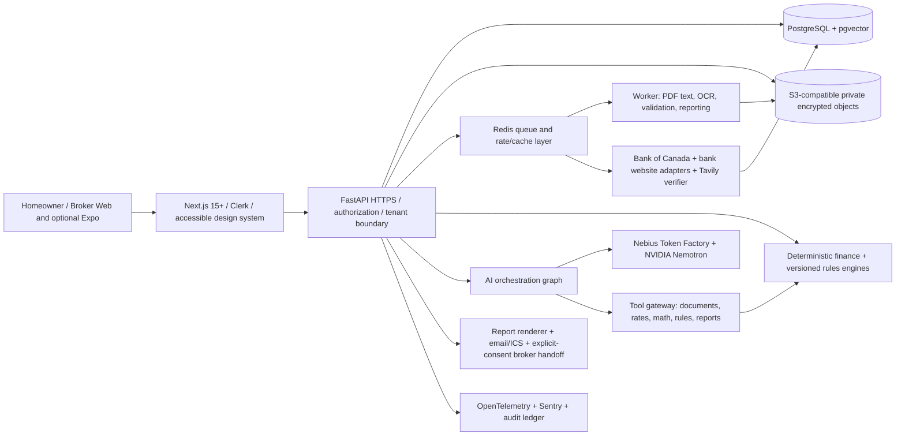

# Renewal Radar 2.0 — Canadian Mortgage Renewal Intelligence

**Product and technical master blueprint | October 11, 2026**  
**Status:** proposed design, **not** implemented, deployed, or submitted. Data illustrations are synthetic unless an official dated observation is cited.  
**Hackathon contexts:** Build North: Ship Something Real (short video at most 2 minutes per supplied brief); Nebius x NVIDIA (deadline Oct 30, 2026; demo video under 3 minutes per supplied brief). Any earlier Renewal Radar work must be disclosed where required. No sign-up or submission is authorized by this blueprint.

## 1. Concept, pitch and commercial objective

**One-line pitch:** *Renewal Radar turns a Canadian mortgage renewal letter into a verified mortgage diagnosis, side-by-side lender economics, a regulatory switching decision, and a ready-to-use negotiation and action plan.*

**Tagline:** *Don't just renew. Renegotiate with evidence.*

**North-star experience:** Upload a renewal letter → verify extracted terms against page-level source citations → pull official and lender-published rates → apply 2026 Canadian renewal/switch rules → compare fully amortized and cash-flow scenarios → estimate contract-specific exit costs → generate the negotiation plan → export and share an auditable report.

The category is not a generic calculator or generic chatbot. It is a **mortgage renewal operating system** for homeowners, and a consent-based retention/decision-support workspace for licensed mortgage professionals. The core defensibility is a carefully versioned policy engine plus deterministic mortgage math and a provenance graph, not a prompt.

### Products and buyers

- **Homeowner free:** upload, diagnosis, one offer comparison, three scenarios, exportable basic report.
- **Homeowner Pro:** more sources, unlimited scenario planning, renewals calendar, family sharing, premium reports.
- **Broker Team:** client workspaces, referral attribution with consent, renewal pipelines, compliant disclosure and co-branded reports.
- **Enterprise/API:** white-label experience, monitored quote feeds, versioned policy API, data and compliance integrations; procurement, security and licensing reviews required.
- **Commercial design constraint:** never sell a user’s renewal letter or share sensitive information with a broker or lender absent explicit, informed consent. Rate comparisons are independent of referral compensation; compensation disclosed when applicable.

### Impact thesis

The Bank of Canada's 2026 Financial Stability Report says the last wave of pandemic-era five-year, fixed-payment mortgages will renew over the following year; roughly 12% of all outstanding mortgages fall into that cohort, with an average projected payment increase around 15%. More Canadian households would benefit from trustworthy tools focused on a forced, high-value decision than from speculative household-finance chatbots. Source: https://www.bankofcanada.ca/publications/financial-stability-report/financial-stability-report-2026/households/

## 2. Killer demonstration — Renewal X-Ray

**Positioning:** The upload is the beginning, not the product. The wow moment is a conditional straight-switch eligibility finding paired with an amortization-correct alternative and a source-backed counteroffer.

### Synthetic fixture for judges

- Renewal letter: invented lender `Maple Bank` (not a real quote), two pages, machine-readable PDF.
- Balance at renewal: CAD 480,000; remaining amortization: 19 years; mortgage renewal offer: 5.49% fixed for three years; frequency: monthly.
- Alternative scenario: hypothetical 4.49% fixed for three years, **not represented as a live market offer**.
- Canadian fixed-rate calculation assumption: nominal annual percentage compounded semi-annually, effective monthly rate `(1+annual_rate/2)^(1/6)-1`, 228 regular monthly payments, and no additional prepayments.
- At 5.49%, monthly principal-and-interest payment: **$3,378.66**. At 4.49%: **$3,122.52**. Monthly cash-flow difference: **$256.14**.
- Modelled interest during the 36-month comparison: **$74,542.72** at 5.49% versus **$60,786.65** at 4.49%, difference **$13,756.07 before switching fees**. At month 36 the lower-rate mortgage has about **$4,535.04 less balance outstanding**. The $256.14 monthly payment saving and $13,756.07 interest saving are **not additive**: the interest result already captures the difference in cash payments and ending principal.
- The synthetic mortgage is additionally tagged as an uninsured, stand-alone mortgage at a federally regulated institution, with no increase in amortization or loan balance. The policy engine labels it **potentially OSFI straight-switch exempt**, subject to evidence of these attributes and lender approval.
- To create the dramatic reveal: show a red flag next to the original offer, a linked OSFI source, two amortization curves, and a one-click negotiation packet including precise questions about all switching fees and eligibility.

**Demo truth policy:** The narrative never says "approved," "guaranteed savings," or "best rate in Canada." The live market drawer shows dated bank-published data separately from hypothetical/demo scenarios.

## 3. Features — ranked backlog

| Rank | Priority | Feature | Homeowner outcome | Engine / acceptance threshold |
|---:|:---:|---|---|---|
| 1 | P0 | Renewal X-Ray | Whole case in one view | Cross-document, rate, finance, policy evidence trace |
| 2 | P0 | Renewal-letter/PDF upload | Avoid manual re-entry | PDF validation, hash, no scanning leaks |
| 3 | P0 | Page-linked AI extraction | Trust numbers extracted from lender | Bounding-box citations; field-by-field corrections |
| 4 | P0 | 2026 switch-rules classifier | Know when a switch may avoid prescribed MQR | Insured/uninsured/refinance branches; dated rules |
| 5 | P0 | Deterministic amortization | Accurate payments, principal and interest | Fixed and variable models, penny reconciliation |
| 6 | P0 | Bank of Canada feed | Official policy and benchmark context | Valet ingestion with timestamps and stale status |
| 7 | P0 | Major-bank rates | Compare lender-published alternatives | RBC, TD, Scotia, BMO, CIBC, National; typed source |
| 8 | P0 | Fixed vs variable vs term comparison | Compare choices at same horizon | 1/2/3/5 year plans, prime paths, equal terms |
| 9 | P0 | Stress-path studio | Understand rate shocks and uncertainty | Base, -100, +100, +200 bp + custom paths |
| 10 | P0 | Net savings engine | Show economically honest result | Fees + interest + remaining principal + NPV |
| 11 | P0 | Penalty workbench | Compare prepayment charges | 3-month interest and lender-specific IRD estimate |
| 12 | P0 | Negotiation coach | Get concrete counteroffer language | Source-cited editable letter and phone script |
| 13 | P0 | Action plan | Get to signed renewal without missing dates | Time-bound checklist and ICS export |
| 14 | P0 | Professional shareable PDF | Give actionable record to family or broker | Formula, source, assumptions, timestamp appendix |
| 15 | P0 | No-login sample mode | Make judge demo work instantly | Fully synthetic, resettable golden path |
| 16 | P1 | Offer-vs-quote truth labels | Avoid confusing posted with contract offers | Published / personalized / hypothetical badges |
| 17 | P1 | Collateral-charge and HELOC diagnostics | Identify switch friction | Reads docs; combined-loan flags and costs |
| 18 | P1 | Mortgage insurance transfer assessment | Avoid duplicate-premium surprises | Insurer certificate and premium portability pathway |
| 19 | P1 | Prepayment privilege optimizer | Evaluate annual lump sums | Contract caps, timing, term interest impact |
| 20 | P1 | Fixed-payment variable trigger detection | Understand amortization shock | Trigger-rate and negative-amortization alerts |
| 21 | P1 | Extending amortization trade-off | Lower payment vs higher total interest | Same horizon with terminal balance disclosed |
| 22 | P1 | Renewal alert calendar | Avoid passive auto-renewal | 120/90/60/30/21/7-day configurable reminders |
| 23 | P1 | Rate-watch alerts | Track meaningful changes | Verified source updates and delta threshold |
| 24 | P1 | Explain-my-number drawer | Challenge or understand every figure | Calculation input, formula and source link |
| 25 | P1 | Broker consent-based handoff | Get human help when needed | Explicit permission, audit log, disclosure |
| 26 | P1 | Broker dashboard | Manage client renewals at scale | Tenant boundaries and workflow statuses |
| 27 | P1 | Offer upload and comparison | Compare actual lender term sheets | Normalizes conditions, portability, prepayment |
| 28 | P1 | Read-only family report link | Get second opinion safely | Expiration, revoke, no default public indexing |
| 29 | P1 | Scenario save/compare | Make a confident choice | Snapshot immutable assumptions with data date |
| 30 | P1 | Bilingual EN/FR | Canada-wide accessibility | Tested legal/mortgage term translations |
| 31 | P2 | Payment-risk heatmap | Know affordability under income shocks | Household budget and emergency-cushion input |
| 32 | P2 | Government-bond context panel | Understand fixed-rate changes | 2/3/5-year yield history with caveats |
| 33 | P2 | Modelled negotiation value score | Prioritize best bank call | Clear heuristic, not false AI precision |
| 34 | P2 | Broker CRM/webhooks | Activate professional workflow | Signed webhooks and duplicate-proof leads |
| 35 | P2 | Agent memory | Remember homeowner-approved preferences | Scoped opt-in memory; visible edit and delete |
| 36 | P2 | White-label institutional edition | Commercial deployment | Tenant themes, disclosures, audit exports |
| 37 | P2 | Bank offer discrepancy detector | Catch mismatch or missing required terms | Renewal letter checks against FCAC rules |
| 38 | P2 | Property equity and LTV input | Assess refinance feasibility | User-provided or licensed valuation; provenance |
| 39 | P2 | Mobile capture companion | Photograph and upload statements | Expo app only when needed, offline queue |
| 40 | P2 | Anonymous impact metrics | Demonstrate real-world value | Measure verified user outcomes, not estimated wins |

### Cross-cutting acceptance criteria

- Every numeric conclusion traces to a formula and typed input set, not an LLM-generated arithmetic answer.
- Every quote has source URL, publication/observation time, retrieval time, transaction type, jurisdiction, term, rate type, rate vs APR, conditions, and freshness indicator.
- Every uploaded letter is treated as untrusted content and cannot direct tools or retrieve other tenants' data.
- Every policy branch is versioned by effective date and returns reason codes plus links to authority.
- Users can correct any extracted value before making a decision, and such corrections are recorded.

## 4. Canadian regulatory truth table (October 2026)

| Path | Prescribed qualifying test? | Determination logic | Important caution |
|---|---|---|---|
| Same lender, ordinary renewal | Typically no new OSFI origination-style MQR requirement solely for an unchanged renewal | Existing lender and no new credit | Lender still applies servicing/risk policy; no guaranteed terms |
| Uninsured stand-alone FRFI → FRFI straight switch at renewal | **OSFI does not prescribe the MQR** since 2024-11-21 | No increase in contractual remaining amortization or loan balance beyond permitted up-to-$3,000 eligible transaction costs; no equity takeout | Underwriting and debt service review still occur; combined loan plans excluded |
| Eligible insured straight switch at renewal | **Reapplication of MQR generally exempt** | Check existing mortgage default insurance, balance/amortization and transfer conditions | Insurer/lender must accept transfer, and other criteria continue to apply |
| Eligible low-ratio portfolio-insurance switch to a new lender | Potentially no portfolio-insurance MQR if stated criteria hold, under amendments effective for insurer applications starting 2024-12-16 | Original federally regulated loan previously stress-tested; amortization unchanged; no cash-out; eligible fees limits | Distinct insurer rules; avoid blanket assumption all non-bank lenders are exempt |
| Refinance, cash-out, material new credit or an increased amortization | Generally apply ordinary underwriting, which typically includes **max(contract + 2.00 pp, 5.25%)** for new uninsured FRFI origination | New principal, equity withdrawal, additional amortization, or product changes | LTV, insurer rules, lender criteria and provincial specifics still matter |
| Early term termination rather than switch at maturity | Contract penalties may apply | Contract type, timing, posted rates and privilege balances | IRD differs across lenders and contracts; no universal exact formula |

**Primary sources:**

- OSFI MQR: https://www.osfi-bsif.gc.ca/en/supervision/financial-institutions/banks/minimum-qualifying-rate-uninsured-mortgages
- OSFI stand-alone straight-switch letter and footnotes: https://www.osfi-bsif.gc.ca/en/guidance/guidance-library/osfi-exempts-uninsured-mortgage-straight-switches-prescribed-mqr-implements-portfolio-lti-limits
- Finance Canada insured-switch Charter mention: https://www.canada.ca/en/department-finance/news/2024/12/boldest-mortgage-reforms-in-decades-come-into-force-today.html
- Finance Canada low-ratio portfolio-insurance parameters: https://www.canada.ca/en/department-finance/news/2024/12/straight-switches-and-portfolio-insurance.html
- FCAC renewal, switching costs, automatic renewal, collateral charges: https://www.canada.ca/en/financial-consumer-agency/services/mortgages/renew-mortgage.html
- FCAC mortgage penalties and IRD methods: https://www.canada.ca/en/financial-consumer-agency/services/mortgages/reduce-prepayment-penalties.html

**Important FCAC consumer protection feature:** federally regulated lenders must provide the renewal statement at least **21 days** before the existing term expires, with remaining balance, offered interest rate, frequency, term and fees, subject to applicable detailed requirements. This should appear as a disclosure checklist, not legal advice.

## 5. Canadian market data — exact source catalogue

### Official API feeds

| Provider / purpose | URL / series | Use and cadence |
|---|---|---|
| Bank of Canada Valet documentation | https://www.bankofcanada.ca/valet/docs/ | Official no-key API specification |
| BoC overnight target, `V39079` | https://www.bankofcanada.ca/valet/observations/V39079/json?recent=5 | Fetch by observation date; last verified 2026-10-08: **2.25%** |
| BoC conventional 5-year posted benchmark, `V80691335` | https://www.bankofcanada.ca/valet/observations/V80691335/json?recent=5 | Weekly modal major-bank posted rate; last verified 2026-10-07: **6.19%** |
| BoC 1-year and 3-year posted mortgage benchmarks | https://www.bankofcanada.ca/valet/observations/V80691333,V80691334/json?recent=5 | Weekly market context, not individualized offers |
| BoC typical bank prime, `V80691311` | https://www.bankofcanada.ca/valet/observations/V80691311/json?recent=5 | Weekly published benchmark, not necessarily lender-specific prime |
| GoC 5-year bond, `V39053` | https://www.bankofcanada.ca/valet/observations/V39053/json?recent=5 | Funding/market context, **not** a quoted fixed mortgage rate |
| BoC major-bank posted-rate methodology | https://www.bankofcanada.ca/rates/banking-and-financial-statistics/posted-interest-rates-offered-by-chartered-banks/ | Explains mode-of-six methodology |
| BoC 2026 renewal analysis | https://www.bankofcanada.ca/publications/financial-stability-report/financial-stability-report-2026/households/ | Market-need evidence, not individual prediction |

### Big-six official lender rate pages

| Lender | Official source | Ingestion strategy |
|---|---|---|
| RBC | https://www.rbcroyalbank.com/mortgages/mortgage-rates.html | Special/posted, term, switch category, insurance, APR, prime |
| TD | https://www.td.com/ca/en/personal-banking/products/mortgages/mortgage-rates | Posted/special, province and contract caveats |
| Scotiabank | https://www.scotiabank.com/ca/en/personal/rates-prices/mortgages-rates.html | Variable/closed/open and other stated conditions |
| BMO | https://www.bmo.com/en-ca/main/personal/mortgages/mortgage-rates/ | Posted/special and Smart Fixed distinctions |
| CIBC | https://www.cibc.com/en/interest-rates/mortgage-rates.html | Discounted vs posted must not be confused |
| National Bank | https://www.nbc.ca/personal/mortgages/rates.html | Verify client-rendered values; avoid template placeholders |

**Critical engineering reality:** These are public official webpages, not six guaranteed public machine-readable mortgage-rate APIs. Each bank's crawler needs legal/terms review, parser contracts, breakage alerts, and a manual verified fallback. Do not print a rate as live if JavaScript/template placeholders were not resolved or the timestamp is too old. Tavily helps discover/corroborate official source URLs; it must never be the financial database of record or imply a lender made a personalized offer.

### Additional verified regulatory/commercial data sources

- FCAC interest/amortization and variable-rate warning: https://www.canada.ca/en/financial-consumer-agency/services/mortgages/interest-on-mortgages.html
- FCAC disclosure rules and amortization: https://www.canada.ca/en/financial-consumer-agency/services/rights-responsibilities/rights-mortgages/applying-for-mortgage.html
- FSRA Ontario mortgage broker disclosure and referral rules: https://www.fsrao.ca/industry/mortgage-brokering/compliance-and-other-resources/mortgage-brokerage-disclosure-requirements
- OPC PIPEDA consent: https://www.priv.gc.ca/en/privacy-topics/privacy-laws-in-canada/the-personal-information-protection-and-electronic-documents-act-pipeda/p_principle/principles/p_consent/
- OPC PIPEDA safeguards: https://www.priv.gc.ca/en/privacy-topics/privacy-laws-in-canada/the-personal-information-protection-and-electronic-documents-act-pipeda/p_principle/principles/p_safeguards
- ISED CASL consent for commercial emails/texts: https://www.ised-isde.canada.ca/site/canada-anti-spam-legislation/en/getting-consent-send-email

## 6. Full production architecture

### Recommended stack and responsibility boundaries

- **Frontend:** Next.js + React + TypeScript + Tailwind semantic tokens + Radix/shadcn primitives; React Hook Form/Zod; TanStack Query; ECharts for scenario curves; PDF.js for side-by-side source highlighting; WCAG 2.2 AA target; 390px mobile functional parity; optional Expo later.
- **Identity:** Clerk for fast safe authentication and sponsor relevance; no-login fully synthetic demo; API independently checks Clerk JWT plus object ownership. Production tenants are isolated using scoped queries and PostgreSQL row-level security defense in depth.
- **Backend:** FastAPI / Pydantic v2; Postgres transactions; consistent REST/OpenAPI and async job/status endpoints; Server-Sent Events for agent progress.
- **Documents:** private S3-compatible bucket, presigned upload, MIME/magic verification, antivirus scan, PyMuPDF text+position extraction, table parsing, bounded OCR only when necessary, source image previews; PII redaction before logging.
- **Intelligence:** Nebius Token Factory with deployed **NVIDIA Nemotron open model** selected/pinned at release for Nebius contest compliance; agent graph with explicit tool calls; JSON-schema/Pydantic strict output. Optional model abstraction (including other providers for other sponsor tracks) cannot replace the required substantive Nemotron execution in Nebius demo.
- **Retrieval:** read-only policy source registry and evidence index; `pgvector` only for retrieval, never for policy truth. Tavily for fresh web discovery and source corroboration. Optional Eon search and SurrealDB scoped memory only if they strengthen the UX and sponsor award; avoid stack inflation for the core.
- **Money math:** Python `Decimal` for financial accumulators, tested native float tolerance for rate-path visualization, correct rounding at payment posting; **the AI is prohibited from free-form arithmetic**. Domain models are currency-aware CAD and date/frequency-aware.
- **Workers:** Celery + Redis to refresh market data, ingest PDFs, generate reports and fire consented reminders; idempotent and retry-safe, error queue and human-review fallback.
- **Observability:** OpenTelemetry spans, source freshness panels, queue metrics, extraction confidence histogram, zero PII in logs, model latency/cost accounting, Sentry with scrubbing.
- **Security:** encryption at rest/in transit, scoped service credentials, CSRF/CORS/SSRF protections, private upload URLs, malware scanning, signed report shares with expiration/revoke, purpose-bound consent, retention policy, incident runbook and breach logs.
- **Deploy:** containerized API/workers plus web frontend; managed PostgreSQL and object store; Canada-hosted option after provider and data-residency evaluation. Local docker-compose parity and public no-login demo with synthetic data.

### Agent graph — concrete tool contracts

| Step | Tool / service | Input | Output / guaranteed boundary |
|---|---|---|---|
| 1 | `document_classify` | Document ID | Renewal letter/statement/offer + suspicious/unreadable flags |
| 2 | `extract_mortgage_fields` | File hash + pages | Strict structured fields + confidence + page/box evidence |
| 3 | `validate_mortgage_profile` | Candidate fields | Cross-field consistency, missing data, user-confirmed overrides |
| 4 | `fetch_market_snapshot` | Province, insurance, term and date | Normalized dated quotes + links + eligibility limitations |
| 5 | `evaluate_switch_policy` | Structured loan and route | `exempt / subject_to_mqr / manual_review`, reason codes and source dates |
| 6 | `compute_amortization` | Verified mortgage and rate | Payment ledger, principal, interest and terminal balance |
| 7 | `simulate_rate_paths` | Product type and explicit scenarios | Scenarios + plotted data; **not** LLM-generated predictions |
| 8 | `estimate_break_penalty` | Contract, dates and lender method | IRD/3-month estimates, unknown inputs and lender quote required |
| 9 | `compare_full_cost` | Offers, fee assumptions, horizon | Interest/cash flows/closing costs/terminal debt/NPV |
| 10 | `compose_negotiation_packet` | Accepted facts and cited results | Draft script and counteroffer requiring user review |
| 11 | `build_action_plan` | Maturity, eligibility, milestones | Checklist and ICS reminders |
| 12 | `render_evidence_report` | Snapshot IDs | Signed downloadable PDF and controlled sharing |

**Hard prohibitions:** Agent cannot write the authoritative payment or penalty number, claim underwriting approval, invent rates, trigger a lender application, send private documents or create a broker lead without explicit user consent. Tool actions use least privilege; source PDF content cannot issue commands.

### Data model (main tables)

`tenants`, `users`, `roles`, `consents`, `mortgage_profiles`, `properties`, `documents`, `document_pages`, `extracted_fields`, `evidence_spans`, `lenders`, `rate_offers`, `rate_snapshots`, `market_sources`, `policy_versions`, `policy_evaluations`, `scenarios`, `scenario_runs`, `payment_ledger`, `penalty_estimates`, `comparisons`, `agent_runs`, `tool_traces`, `negotiation_packets`, `action_items`, `reports`, `shares`, `broker_referrals`, `notification_subscriptions`, `audit_events`, `deletion_jobs`.

**Data provenance backbone:** Every calculated result records `algorithm_version`, `input_snapshot_id`, `source_observation_ids`, `rate_assumptions`, `rounding_policy`, and user override history. Every model-written claim references result IDs/evidence IDs. Each generated report is immutable and shows a creation timestamp, not an eternally "live" assertion.

## 7. Financial computation specifications

### Principal and interest payment

For a conventional Canadian fixed mortgage with nominal annual rate `j` compounded semi-annually and monthly payments:

`monthly_effective_rate = (1 + j/2)^(1/6) - 1`

`payment = balance * monthly_effective_rate / (1 - (1 + monthly_effective_rate)^(-months_remaining))`

An explicit zero-rate branch returns `balance/months`. Do **not** divide annual fixed-rate `j` by 12 unless the specific product's contract uses that basis. Support alternate interest conventions driven by lender contracts, not assumptions.

### Variable contracts

Represent lender-specific *fixed-payment variable* and *adjustable-payment variable* distinctly, with prime-spread, repricing dates, daily/monthly accrual as disclosed, trigger thresholds, conversion terms and late-term forced-payment changes. Do not automatically turn every BoC policy-rate change into a same-day lender-prime change.

### Penalty calculation

Three-month-interest illustrative method: `prepay_amount × contract_annual_rate × (3/12)` (actual lender method varies). **Interest rate differential cannot be universally calculated from this one formula**. Configure distinct lender formulas with posted rate at origination, contractual discount, comparable remaining term, payoff date, applicable balance, legal terms and disclosed prepayment privileges. Calculate 3-month amount, applicable IRD estimate and known lender maximum (often higher of two for fixed closed), but identify any assumptions and link users to an actual lender payout quote.

### Fair comparison rules

Do not compare 3-year and 5-year products by simply multiplying displayed monthly payments. Require same start balance, horizon, amortization assumptions, fees, payment frequency, and ending balance. Show separately **cash-flow relief**, **interest cost**, **fees**, **remaining debt**, **NPV**, and **unknown tail/renewal-rate risk**. Where horizons differ, provide a neutral common-horizon comparison and label assumptions about renewal rates after a shorter product ends. No "savings" label on unknown/future quote without an assumption badge.

### Required mathematical tests

Zero interest, very short remaining terms, daily versus monthly interest, 365/366-day boundaries, leap day, variable rates falling/rising, negative amortization, accelerated biweekly not equivalent to ordinary biweekly, full prepayment at maturity, partial prepayment allowed limits, remaining amortization changes, fees financed within regulatory limit, CAD half-cent rounding, and different lender APR conventions.

## 8. UX — screen-by-screen specifications

1. **Welcome / No-login Judge Mode:** "Upload your renewal letter. Find your leverage." Drag-and-drop, anonymized demo selection, privacy promise. No credit-score or income request up front.
2. **Consent and Data Purpose:** explain what the app extracts and which external processor/model sees data, retention and choice of anonymous demo; no pre-checked marketing opt-in.
3. **My Renewal Dashboard:** maturity countdown, last source refresh, next task, payment-risk estimate, "What changed since last visit?" and homeowner goals.
4. **Document Upload:** PDF quality status, page count, encrypted upload, file-type constraints, progressive scan milestones, pause/delete controls.
5. **Verify Your Mortgage:** renewal letter at left, source-linked fields at right; highlight exact page/bounding box; low-confidence items visibly "needs confirmation".
6. **Renewal X-Ray:** three diagnostic cards (offer competitiveness, regulatory switch pathway, renewal cash-flow impact), not one opaque AI score; explanations open evidence drawer.
7. **Live Market Radar:** date stamped BoC overnight policy, bond trend, big-six posted/special offers, lender-specific prime, geography and product-type filters; no false "personalized preapproved" badges.
8. **Offer Comparison:** original offer alongside real user-uploaded offers and clearly hypothetical simulations; all fees, terms, APR and prepayment privileges listed.
9. **Scenario Studio:** fixed/variable and 1/2/3/5-year controls; timeline editor for -100, 0, +100, +200 bps; cash-flow bars and terminal balance/interest curves; comparison horizon warning.
10. **Switch Eligibility:** human-readable decision tree, qualifying attributes, "potentially exempt" outcome, why MQR applies or doesn't, lender-underwriting note, direct OSFI/Finance source links.
11. **Break Penalty Explorer:** IRD vs three-month interest estimates; date-to-maturity slider, posted-rate comparison, contract data gaps and "get actual payout statement" action.
12. **Prepayment Optimizer:** allowed annual lump sum and accelerated payments, interest projection, prepayment caps, budget safety reminder.
13. **Negotiation Workbench:** adjustable desired concession/rate, evidence from actual comparison, call script and secure copy, employer/broker share with consent; no auto-emailing banks.
14. **Action Plan:** dated cards such as verify rate, request payout, check discharge/registration costs, get insurer certificate, confirm lock/rate hold, pick settlement date, confirm final instruction.
15. **Report Centre:** professional 4–8 page PDF, summary and full audit edition; expiring/revocable links, no private fields shown by default on public preview.
16. **Broker Workspace:** due-soon pipeline, client authorization, scenario discussion, decision record and fee/commission disclosure; advisor owns advice, not AI.
17. **Privacy and Settings:** source delete, export, reminder consent, account and tenant privacy policies, request data deletion, switching off AI memory, bilingual language.
18. **Error/Recovery UX:** stale market rate → date-stamped cached value; PDF parse failure → manual entry; uncertain switch classification → manual review; model down → deterministic finance results still usable.

**Visual direction:** sophisticated Canadian-fintech look—not casino aesthetics. Ink navy, pine/emerald as a calm accent, warm off-white, sparing amber for caution. Dense analyst data in progressive disclosure; huge typography for one high-stakes number, simple charts, readable source pills and consistent 'estimated' labels. Avoid red/green-only semantics and preserve WCAG contrast and keyboard focus.

## 9. 3-minute judge demonstration and under-2-minute alternate

### 3-minute cut (Nebius)

| Clock | On-screen action | Narration and judging value |
|---|---|---|
| 0:00–0:15 | Mortgage renewal letter + product hook | "Canadians don't need another rate chart. They need someone to read this offer and tell them what to do." — Idea/Impact |
| 0:15–0:35 | Upload synthetic PDF, show page citations | "The agent extracts terms and points to the exact line it read." — Technology/Trust |
| 0:35–0:55 | Reveal Renewal X-Ray | "It detects a potential stand-alone uninsured straight switch. That's important because the OSFI MQR exemption changes shopping options, not guaranteed approval." — Canadian depth |
| 0:55–1:18 | BoC data + lender comparison with timestamps | "Market data is traceable, not made-up AI rates." — Data/Engineering |
| 1:18–1:43 | Change rate path and show fixed/variable graph | "All payments and remaining principal are calculated by a deterministic finance engine." — Tech/Design |
| 1:43–2:03 | Penalty calculator and switch cost toggle | "An interest saving that ignores break penalties is not a real answer." — Credibility |
| 2:03–2:30 | Generate negotiation packet + shareable report | "Here's the counteroffer, the supporting mathematics, and next week's checklist." — Impact |
| 2:30–2:47 | Show agent trace/tool names / model gateway | "Nemotron runs on Nebius; tool calls use policy and math engines, with strict evidence guardrails." — Technical rubric |
| 2:47–3:00 | Key metric + broker workflow teaser | "Renewal Radar turns an anxious letter into a documented decision. Next: every Canadian homeowner with a mortgage renewal." — Commercial path |

### Build North under-two-minute cut

Delete rate-path deep dive, shorten architecture reveal, compress upload and letter parsing with a preloaded synthetic document. Preserve **upload → evidence → switch rule → comparison → negotiation packet**. The demo should still work without a login or a paid key. Public video length/Devpost and prior-work disclosure must be reconfirmed from final contest rules before submission.

## 10. Milestone plan

| Stage | Target | Deliverable | Exit gate |
|---|---|---|---|
| 0 — architecture/fixture | Before new-build eligibility period | Sources, synthetic sample letters, threat model, UX flows and previously developed inventory | Contest prior-work disclosure drafted; no code misrepresented as new |
| 1 — vertical slice | — | Working Next.js / API / auth or demo bypass, core dashboard, finance library | One end-to-end synthetic homeowner flow |
| 2 — true document agent | — | PDF extraction, highlights, strict schemas, Nemotron agent | 95%+ correct required fields on curated clean letter corpus; mistakes require review |
| 3 — Canada rules and math | — | Uninsured/insured classification, 2026 MQR, payment/penalty engine | All golden mortgage and policy tests pass |
| 4 — market and comparisons | — | BoC official adapter, 2–3 reliable bank adapters, comparison charts | Freshness and provenance visible; other banks staged honestly |
| 5 — shareable impact | — | Script, action plan, branded PDF and sample sharing | Printable auditable result; no fabricated quote |
| 6 — harden and cut video | — | Mobile tests, no-login mode, security review, fallback, short demo | Live URL, public MIT repo, correct prior-work disclosure, ≤2m video; human approval to submit |
| 7 — Nebius finalist expansion | — | Nemotron substantive run, Tavily source verifier, more bank adapters, trace viewer, broker teaser | Meets Nebius rules, <3m YouTube video and feedback form; documented model ID |
| 8 — submission deadline | Oct 30, 1:00 PM ET per supplied brief | Complete Nebius entry | Obtain explicit owner's approval first |
| 9 — commercialization | After hackathons, 3–6 months | Multi-tenant SaaS, complete lender coverage, additional regulation checks, penetration test, privacy counsel review, broker pilot | Paid pilots, signed lender/data rights as needed, security evidence |

**Build-week reality:** shipping the entire estimated 77k-line codebase in 10 days would be irresponsible. A compelling hackathon vertical slice is **6k–10k tested lines**, plus preexisting disclosed work, with the remaining modules staged. Judges should see a robust working narrow product, not 50 static screens.

### Quality and measurement goals (targets, not claims of achievement)

- End-to-end synthetic demo succeeds on 20 consecutive clean runs; first meaningful result under 60 seconds with fast path and cached sources, network variability permitted with visible status.
- Zero critical/major security findings before accepting real consumer uploaded statements; launch with synthetic demo mode until external processor, retention, breach and privacy review are complete.
- 100% important policy conclusions and 100% displayed monetary amounts carry an audit route.
- 100% external rate records show provenance and observation time; stale rate never silently substituted.
- Finance golden fixtures reconcile to independent amortization reference calculators to tolerance defined by rounding rules.
- E2E paths tested at 390px wide, with screen reader announcements, keyboard navigation and contrast checks.
- Pilot business metrics: percentage completing upload, verified quote delta, negotiation packet usage, confirmed savings based on signed offers, broker opt-in conversion, complaint rate; **never claim estimate as realized saving**.

## 11. Why it wins — technology, design, impact and idea

| Judge criterion | Renewal Radar proof |
|---|---|
| Technology | Nemotron/Nebius tool-calling agent; actual PDF evidence coordinates; deterministic amortization; versioned policy DSL; live BoC + monitored bank adapters; security and observability, not just a chat wrapper |
| Design | Instant no-login sample; compelling X-Ray reveal; source-linked correction; interactive scenarios; graceful mobile and error states; outcome-driven report rather than enormous form |
| Impact | High-consequence renewal event, concrete cash-flow impact, legal-eligibility clarification, one usable negotiation artifact, broker handoff only with consent |
| Idea | Combines contract-reading, law-aware switch qualification, market sourcing, scenario fairness, contract break costs and negotiation into one documented decision |
| Commercial story | Consumer trust layer + paid broker workflow + enterprise API; multiple recurring touchpoints from pre-renewal to closing; capacity for verified outcomes |

**Competitive framing:** Rate comparison sites are good at showing rates. Bank portals show their own products. Mortgage calculators show payment scenarios. General LLMs can summarize letters. Renewal Radar's differentiator is the **provable transformation from an actual document to a constrained, verified action** with correct 2026 regulatory branches. Do not assert that no competitor offers any overlapping feature without a systematic competitor audit.

## 12. Risk register and kill switches

1. **Unknown contract IRD formula:** show illustrative range and direct link to lender quote calculator; suppress "exact penalty".
2. **Ambiguous switch eligibility:** show manual-review required and source of uncertainty; never promise exemption or approval.
3. **Bank website parser stale/blocked:** use last *dated* snapshot and suspend that lender's live badge; never fake rates.
4. **PDF prompt injection:** isolate as data, sanitize and disallow instructions, run tool policies outside document context.
5. **PDF contains SIN/bank account details:** minimize extraction, mask in previews and telemetry, allow immediate delete; disclose third-party AI processing.
6. **Lender promotional rates contingent on insurance/owner occupancy/province:** classify condition tags; avoid false cross-offer ranking.
7. **Adverse variable path and trigger scenario:** alert on negative amortization and forced payment changes.
8. **Interest savings presented as cash-flow savings:** show separately; never add overlapping financial measures.
9. **Broker conflicts:** explicit licensing/referral/commission disclosure, homeowner chooses whether to share case.
10. **Regulatory changes:** dated rule registry, review owners, test cases, versioned notices. Do not silently update historical outputs.

## 13. File-by-file implementation plan (estimated original source lines)

The following manifest specifies production modules and approximate authored lines. It is **planning, not files that have been built**. Estimates include frontend, backend, deterministic finance/policy, PDF agent, data ingestion, security, infrastructure, and tests; they exclude dependencies, binary assets and generated vendor bundles. Divide by ~60 printed lines per page for a rough page estimate; actual page count varies by print settings.

### 00 Platform, infrastructure and CI

| File | Est. LOC | Purpose |
|---|---:|---|
| `pnpm-workspace.yaml` | 40 | workspace boundaries and package filters |
| `turbo.json` | 90 | cacheable monorepo build targets |
| `package.json` | 110 | root scripts and pinned tooling |
| `docker-compose.yml` | 220 | local API, database, Redis and object store |
| `Makefile` | 180 | developer commands and smoke tests |
| `.env.example` | 100 | documented environment settings |
| `.github/workflows/ci.yml` | 280 | lint, test, contract and build gates |
| `.github/workflows/security.yml` | 220 | SAST, dependency and secret scans |
| `infra/terraform/main.tf` | 550 | network and stateful infrastructure |
| `infra/terraform/services.tf` | 520 | API, workers and queues |
| `infra/terraform/monitoring.tf` | 350 | telemetry dashboards and alerts |
| `infra/k8s/overlays/production.yaml` | 280 | production deployment policies |

**Subtotal:** 12 files; **2,940 LOC**.

### 01 Shared contracts and SDKs

| File | Est. LOC | Purpose |
|---|---:|---|
| `packages/contracts/src/mortgage.ts` | 420 | normalized mortgage profile and strict types |
| `packages/contracts/src/offer.ts` | 350 | rate-offer and eligibility contract |
| `packages/contracts/src/rules.ts` | 350 | versioned Canadian policy result schema |
| `packages/contracts/src/documents.ts` | 420 | evidence spans and confidence schema |
| `packages/contracts/src/scenarios.ts` | 430 | scenario input and output DTOs |
| `packages/contracts/src/reports.ts` | 270 | report and share-link schemas |
| `packages/contracts/src/events.ts` | 320 | auditable workflow event contracts |
| `packages/sdk/src/client.ts` | 520 | typed HTTP client, retries and pagination |

**Subtotal:** 8 files; **3,080 LOC**.

### 02 Web foundation and design system

| File | Est. LOC | Purpose |
|---|---:|---|
| `apps/web/src/app/layout.tsx` | 180 | document metadata and shell |
| `apps/web/src/app/providers.tsx` | 250 | auth, query and theme providers |
| `apps/web/src/styles/tokens.css` | 420 | semantic colour, type and spacing tokens |
| `apps/web/src/styles/globals.css` | 350 | global styles and print treatment |
| `apps/web/src/components/ui/button.tsx` | 240 | semantic button variants |
| `apps/web/src/components/ui/form-fields.tsx` | 420 | validated inputs and masks |
| `apps/web/src/components/ui/modal.tsx` | 230 | accessible sheets and modals |
| `apps/web/src/components/ui/data-table.tsx` | 410 | responsive sortable tables |
| `apps/web/src/components/ui/notice.tsx` | 230 | risk alerts and source warnings |
| `apps/web/src/components/ui/chart-frame.tsx` | 300 | accessible interactive chart frame |
| `apps/web/src/components/nav/sidebar.tsx` | 290 | responsive workflow navigation |
| `apps/web/src/components/nav/topbar.tsx` | 270 | search, status and account actions |
| `apps/web/src/components/finance/money.tsx` | 330 | currency and frequency formatters |
| `apps/web/src/lib/accessibility.ts` | 360 | focus, announcements and keyboard helpers |

**Subtotal:** 14 files; **4,280 LOC**.

### 03 Homeowner and broker UX screens

| File | Est. LOC | Purpose |
|---|---:|---|
| `apps/web/src/app/(public)/page.tsx` | 350 | conversion-focused landing and sample demo |
| `apps/web/src/app/(public)/how-it-works/page.tsx` | 240 | education and disclosure |
| `apps/web/src/app/(app)/dashboard/page.tsx` | 380 | renewal countdown and overview |
| `apps/web/src/app/(app)/onboarding/page.tsx` | 370 | consent, goals and guided setup |
| `apps/web/src/app/(app)/upload/page.tsx` | 430 | document ingestion and status |
| `apps/web/src/app/(app)/evidence/page.tsx` | 390 | source-vs-extracted field inspector |
| `apps/web/src/app/(app)/diagnosis/page.tsx` | 420 | Renewal X-Ray findings |
| `apps/web/src/app/(app)/rates/page.tsx` | 430 | live rates and market provenance |
| `apps/web/src/app/(app)/compare/page.tsx` | 450 | offer comparison and total costs |
| `apps/web/src/app/(app)/scenarios/page.tsx` | 470 | rate-path scenario studio |
| `apps/web/src/app/(app)/switch/page.tsx` | 430 | straight-switch eligibility flow |
| `apps/web/src/app/(app)/penalties/page.tsx` | 380 | IRD and three-month-interest explorer |
| `apps/web/src/app/(app)/negotiation/page.tsx` | 380 | negotiation workspace |
| `apps/web/src/app/(app)/plan/page.tsx` | 360 | checklist and calendar |
| `apps/web/src/app/(app)/reports/page.tsx` | 320 | report generation and sharing |
| `apps/web/src/app/(app)/settings/page.tsx` | 320 | privacy, retention and export |
| `apps/web/src/app/(broker)/clients/page.tsx` | 440 | broker pipeline and client list |
| `apps/web/src/app/(broker)/client/[id]/page.tsx` | 450 | advisor analysis and compliance log |

**Subtotal:** 18 files; **7,010 LOC**.

### 04 Frontend feature implementations

| File | Est. LOC | Purpose |
|---|---:|---|
| `apps/web/src/features/upload/dropzone.tsx` | 380 | encrypted upload progress and validation |
| `apps/web/src/features/upload/pdf-viewer.tsx` | 480 | page preview and evidence highlighting |
| `apps/web/src/features/evidence/field-review.tsx` | 370 | human verification and overrides |
| `apps/web/src/features/rates/rate-grid.tsx` | 410 | lender rate filtering and freshness |
| `apps/web/src/features/rates/rate-timeline.tsx` | 350 | historical rate trends |
| `apps/web/src/features/scenarios/path-editor.tsx` | 470 | interactive rate path editing |
| `apps/web/src/features/scenarios/payment-chart.tsx` | 470 | payments, interest and balances |
| `apps/web/src/features/scenarios/fan-chart.tsx` | 420 | uncertainty visualization |
| `apps/web/src/features/switch/eligibility-tree.tsx` | 390 | visible rule evaluation tree |
| `apps/web/src/features/negotiation/script-editor.tsx` | 360 | editable lender-specific scripts |
| `apps/web/src/features/plans/task-board.tsx` | 370 | milestone and reminder editing |
| `apps/web/src/features/reports/share-dialog.tsx` | 290 | expiring share-link controls |

**Subtotal:** 12 files; **4,760 LOC**.

### 05 API and application services

| File | Est. LOC | Purpose |
|---|---:|---|
| `apps/api/app/main.py` | 210 | FastAPI setup and typed lifespan |
| `apps/api/app/config.py` | 240 | settings and feature flags |
| `apps/api/app/api/v1/auth.py` | 300 | session and token authorization |
| `apps/api/app/api/v1/mortgages.py` | 450 | profiles and ownership routes |
| `apps/api/app/api/v1/documents.py` | 430 | upload, scan and evidence routes |
| `apps/api/app/api/v1/rates.py` | 370 | snapshot and offer endpoints |
| `apps/api/app/api/v1/scenarios.py` | 440 | scenario execution and persistence |
| `apps/api/app/api/v1/switches.py` | 380 | policy classification routes |
| `apps/api/app/api/v1/agent.py` | 370 | agent task and streaming endpoints |
| `apps/api/app/api/v1/reports.py` | 340 | PDF rendering and link routes |
| `apps/api/app/api/v1/brokers.py` | 430 | tenant-separated broker workflow |
| `apps/api/app/services/orchestration.py` | 620 | workflow commands and idempotency |

**Subtotal:** 12 files; **4,580 LOC**.

### 06 Deterministic Canadian finance engine

| File | Est. LOC | Purpose |
|---|---:|---|
| `packages/finance/interest.py` | 640 | semi-annual nominal and effective rates |
| `packages/finance/payment.py` | 620 | monthly and frequency-aware schedules |
| `packages/finance/amortization.py` | 700 | cash-flow and outstanding balance engine |
| `packages/finance/variable.py` | 660 | fixed-payment vs adjustable-payment VRMs |
| `packages/finance/trigger_rates.py` | 540 | trigger point and amortization expansion |
| `packages/finance/prepayment.py` | 600 | lump-sum and accelerated payment optimizer |
| `packages/finance/penalty.py` | 690 | lender-configured 3-month and IRD methods |
| `packages/finance/comparisons.py` | 640 | matched-horizon net cost comparisons |
| `packages/finance/present_value.py` | 450 | NPV and terminal-equity methodology |
| `packages/finance/scenarios.py` | 670 | time-series shock and rate-path simulator |
| `packages/finance/affordability.py` | 510 | GDS, TDS, MQR and affordability flags |

**Subtotal:** 11 files; **6,720 LOC**.

### 07 Canadian policy and eligibility engine

| File | Est. LOC | Purpose |
|---|---:|---|
| `packages/rules/engine.py` | 550 | typed rule executor and trace |
| `packages/rules/insured_switch.py` | 510 | insured straight-switch route |
| `packages/rules/uninsured_switch.py` | 590 | OSFI uninsured stand-alone tests |
| `packages/rules/portfolio_insurance.py` | 430 | low-ratio portfolio-insurance conditions |
| `packages/rules/refinance.py` | 480 | cash-out and term extension classification |
| `packages/rules/collateral_charge.py` | 420 | combined loan and collateral restrictions |
| `packages/rules/provinces.py` | 420 | province-specific cost/disclosure metadata |
| `packages/rules/versioned_sources.py` | 370 | effective dates and provenance |

**Subtotal:** 8 files; **3,770 LOC**.

### 08 AI agent and model gateway

| File | Est. LOC | Purpose |
|---|---:|---|
| `apps/agent/graph.py` | 590 | graph-based multi-step agent control flow |
| `apps/agent/state.py` | 340 | validated agent state and checkpoints |
| `apps/agent/model_gateway.py` | 420 | Nemotron on Nebius and optional fallbacks |
| `apps/agent/prompts/extract.py` | 360 | schema-constrained extraction prompts |
| `apps/agent/prompts/explain.py` | 350 | cited diagnosis prompts |
| `apps/agent/prompts/negotiate.py` | 330 | fact-checked negotiation prompts |
| `apps/agent/tools/documents.py` | 430 | fetch allowed document evidence |
| `apps/agent/tools/market.py` | 390 | query normalized and cached market data |
| `apps/agent/tools/finance.py` | 370 | invoke deterministic calculators |
| `apps/agent/tools/policy.py` | 370 | invoke effective-date rules |
| `apps/agent/guardrails.py` | 480 | injection resistance and claim validators |
| `apps/agent/evals.py` | 430 | answer grounding and benchmark suite |

**Subtotal:** 12 files; **4,860 LOC**.

### 09 PDF/document intelligence

| File | Est. LOC | Purpose |
|---|---:|---|
| `apps/worker/documents/ingest.py` | 350 | virus scan, hash and MIME verification |
| `apps/worker/documents/text_extract.py` | 480 | text and table parsing with positions |
| `apps/worker/documents/ocr.py` | 480 | low-confidence scanned-page OCR |
| `apps/worker/documents/classify.py` | 350 | document type and lender classifier |
| `apps/worker/documents/normalize.py` | 510 | field normalization and units |
| `apps/worker/documents/validate.py` | 520 | cross-field contradiction checks |
| `apps/worker/documents/redact.py` | 380 | PII redaction and retention rules |
| `apps/worker/documents/evidence.py` | 520 | page-box links, confidence and review |

**Subtotal:** 8 files; **3,590 LOC**.

### 10 Market data and scheduled pipelines

| File | Est. LOC | Purpose |
|---|---:|---|
| `apps/worker/rates/boc_valet.py` | 430 | BoC policy and benchmark yield connector |
| `apps/worker/rates/boc_posted.py` | 350 | major-bank modal posted benchmark data |
| `apps/worker/rates/rbc.py` | 380 | RBC source adapter and parsing |
| `apps/worker/rates/td.py` | 380 | TD source adapter and parsing |
| `apps/worker/rates/scotiabank.py` | 370 | Scotiabank source adapter |
| `apps/worker/rates/bmo.py` | 360 | BMO source adapter |
| `apps/worker/rates/cibc.py` | 360 | CIBC source adapter |
| `apps/worker/rates/national.py` | 360 | National Bank source adapter |
| `apps/worker/rates/normalize.py` | 540 | rate, province and feature taxonomy |
| `apps/worker/rates/quality.py` | 500 | freshness, anomalies and legal review |
| `apps/worker/rates/scheduler.py` | 370 | refresh jobs, retry and snapshots |
| `apps/worker/rates/tavily_verify.py` | 340 | Tavily link discovery and corroboration |

**Subtotal:** 12 files; **4,740 LOC**.

### 11 Reports, reminders and integrations

| File | Est. LOC | Purpose |
|---|---:|---|
| `apps/worker/reports/assemble.py` | 410 | evidence-backed report composition |
| `apps/worker/reports/pdf.py` | 520 | accessible PDF layout and pagination |
| `apps/worker/reports/html.py` | 340 | share-safe browser report |
| `apps/worker/reports/audit.py` | 300 | source and formula appendix |
| `apps/worker/notifications/email.py` | 330 | transactional and consented communications |
| `apps/worker/notifications/calendar.py` | 310 | ICS reminders and timezones |
| `apps/worker/integrations/lead_handoff.py` | 390 | explicit-consent CRM handoff |
| `apps/worker/integrations/webhooks.py` | 360 | signed idempotent partner webhooks |

**Subtotal:** 8 files; **2,960 LOC**.

### 12 Persistence and migrations

| File | Est. LOC | Purpose |
|---|---:|---|
| `apps/api/app/db/models.py` | 620 | SQLAlchemy tenants, mortgages and offers |
| `apps/api/app/db/repository.py` | 550 | query boundaries and row permissions |
| `apps/api/app/db/transactions.py` | 370 | unit of work and retry policy |
| `apps/api/app/db/migrations/0001_init.py` | 580 | tenant, subject and document schema |
| `apps/api/app/db/migrations/0002_rates.py` | 450 | quote history and provenance schema |
| `apps/api/app/db/migrations/0003_audit.py` | 430 | agent traces and immutable events |
| `apps/api/app/db/retention.py` | 380 | user deletion, expiry and reconciliation |
| `apps/api/app/db/seed_demo.py` | 340 | completely synthetic judge dataset |

**Subtotal:** 8 files; **3,720 LOC**.

### 13 Security, reliability and observability

| File | Est. LOC | Purpose |
|---|---:|---|
| `apps/api/app/security/authorization.py` | 430 | ABAC, RBAC and tenant assertions |
| `apps/api/app/security/consent.py` | 370 | purpose-bound consent ledger |
| `apps/api/app/security/storage.py` | 350 | encrypted upload and expiring URLs |
| `apps/api/app/security/rate_limit.py` | 340 | abuse limits and quotas |
| `apps/api/app/observability/tracing.py` | 330 | OpenTelemetry traces and redaction |
| `apps/api/app/observability/health.py` | 280 | readiness, liveness and synthetic probes |
| `apps/api/app/resilience/circuit_breakers.py` | 370 | model and third-party failure fallback |
| `apps/api/app/resilience/jobs.py` | 350 | queue retries, DLQ and idempotency |

**Subtotal:** 8 files; **2,820 LOC**.

### 14 Unit, integration, security and browser tests

| File | Est. LOC | Purpose |
|---|---:|---|
| `tests/unit/test_interest.py` | 480 | interest conversion golden vectors |
| `tests/unit/test_payment.py` | 450 | monthly and accelerated pay schedules |
| `tests/unit/test_amortization.py` | 520 | mortgage balance invariants |
| `tests/unit/test_variable.py` | 520 | variable rate and trigger behaviour |
| `tests/unit/test_prepayment.py` | 450 | privilege and payoff constraints |
| `tests/unit/test_penalty.py` | 580 | lender-specific IRD/three-month cases |
| `tests/unit/test_comparisons.py` | 490 | same-horizon fair comparison |
| `tests/unit/test_present_value.py` | 360 | NPV/remaining principal invariants |
| `tests/unit/test_affordability.py` | 450 | stress test MQR scenarios |
| `tests/unit/test_rule_uninsured.py` | 560 | OSFI switch conditions and limits |
| `tests/unit/test_rule_insured.py` | 520 | insured-switch eligibility edge cases |
| `tests/unit/test_rule_portfolio.py` | 390 | portfolio insurance rules |
| `tests/unit/test_rule_refinance.py` | 420 | cash-out and extension flags |
| `tests/unit/test_collateral.py` | 430 | HELOC and combined plan exceptions |
| `tests/unit/test_extract.py` | 480 | PDF extraction fixture suite |
| `tests/unit/test_evidence.py` | 490 | page and bounding-box citations |
| `tests/unit/test_guardrails.py` | 520 | prompt injection and missing source tests |
| `tests/unit/test_rate_normalize.py` | 480 | APR, price and province rate types |
| `tests/unit/test_rate_quality.py` | 480 | timestamp and anomaly checks |
| `tests/unit/test_agent_evals.py` | 530 | regression on known mortgage cases |
| `tests/integration/test_api_mortgages.py` | 430 | tenant CRUD and validation |
| `tests/integration/test_api_documents.py` | 440 | upload, processing and delete |
| `tests/integration/test_api_scenarios.py` | 460 | calculation service integration |
| `tests/integration/test_api_switches.py` | 450 | eligibility API boundary |
| `tests/integration/test_pipeline_boc.py` | 430 | Valet response contract |
| `tests/integration/test_pipeline_banks.py` | 550 | stored HTML fixtures and drift |
| `tests/integration/test_pdf_report.py` | 460 | report semantic sections |
| `tests/security/test_tenant_isolation.py` | 540 | IDOR and tenant boundary |
| `tests/security/test_consent.py` | 450 | consent and opt-out compliance |
| `tests/security/test_file_uploads.py` | 510 | malicious PDF and ZIP rejection |
| `tests/security/test_share_links.py` | 420 | expiry and revoke tests |
| `tests/e2e/renewal_xray.spec.ts` | 510 | 3-minute primary demo workflow |
| `tests/e2e/compare_scenarios.spec.ts` | 510 | rate, term, amortization journey |
| `tests/e2e/broker_workflow.spec.ts` | 480 | broker client pipeline |
| `tests/e2e/mobile_accessibility.spec.ts` | 490 | 390px and keyboard screen-reader flow |
| `tests/load/renewal_spike.py` | 420 | launch-day concurrent uploads |
| `tests/fixtures/generate_synthetic.py` | 420 | non-PII lender-style fixture generator |

**Subtotal:** 37 files; **17,570 LOC**.

### Consolidated engineering budget

| Workstream | Files | Estimated LOC |
|---|---:|---:|
| 00 Platform, infrastructure and CI | 12 | 2,940 |
| 01 Shared contracts and SDKs | 8 | 3,080 |
| 02 Web foundation and design system | 14 | 4,280 |
| 03 Homeowner and broker UX screens | 18 | 7,010 |
| 04 Frontend feature implementations | 12 | 4,760 |
| 05 API and application services | 12 | 4,580 |
| 06 Deterministic Canadian finance engine | 11 | 6,720 |
| 07 Canadian policy and eligibility engine | 8 | 3,770 |
| 08 AI agent and model gateway | 12 | 4,860 |
| 09 PDF/document intelligence | 8 | 3,590 |
| 10 Market data and scheduled pipelines | 12 | 4,740 |
| 11 Reports, reminders and integrations | 8 | 2,960 |
| 12 Persistence and migrations | 8 | 3,720 |
| 13 Security, reliability and observability | 8 | 2,820 |
| 14 Unit, integration, security and browser tests | 37 | 17,570 |
| **TOTAL** | **188** | **77,400** |

**Rough pages:** ~1,290 code pages at 60 lines/page (actual printed pages vary). **Commercial product construction order:** the P0 vertical slice should be implemented first; estimated LOC are a scope budget, not a productivity promise.

## 14. Build and ship gates

**Gate A — demo completeness:** synthetic upload, deterministic finance, explicit 2026 switch classification, live/dated BoC, at least some bank-published verified quotes, editable script, downloadable shareable PDF.

**Gate B — real-document private beta:** PII policy, model/vendor DPA and processing disclosures, breach runbook, independent calculation QA, upload malware protection, rate-page usage rights, retention and delete workflows, external security test.

**Gate C — commercial broker launch:** provincial licensing and marketing review, conflict/referral disclosures, auditable consent, tenant isolation penetration tests, usability and accessibility testing, actual lender eligibility workflows, comprehensive E&O/legal review as appropriate.

**Decision principle:** never build more screens at the cost of the X-Ray demonstration and the truth of the mortgage numbers.
